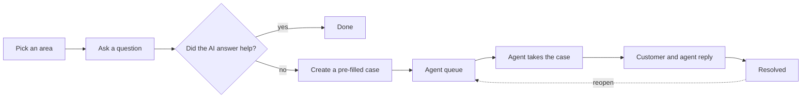
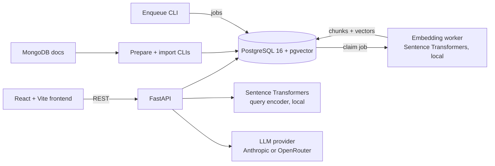
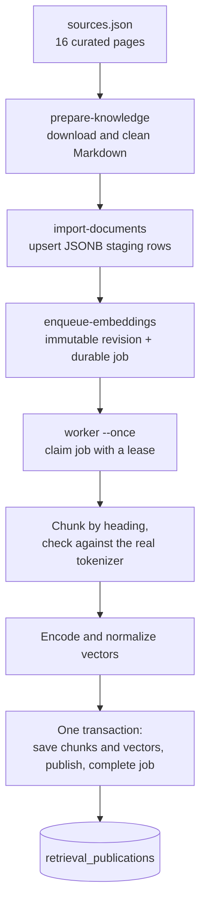
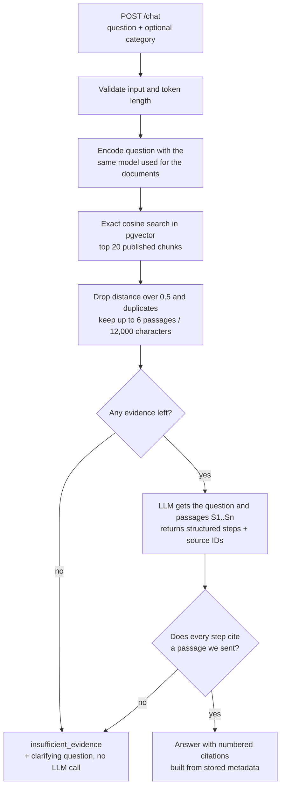
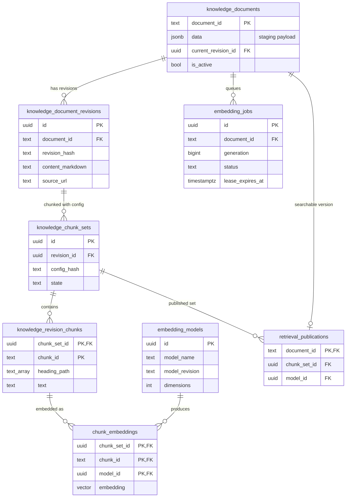
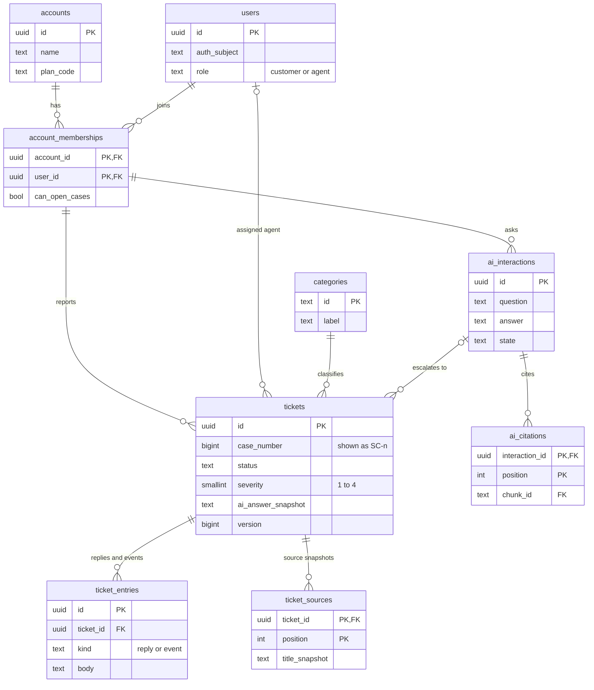

# Support Copilot

A customer-support app where an LLM answers first and a human takes over when it can't help.

A customer picks a product area and asks a question. The app searches a knowledge base of official MongoDB documentation, gives the relevant passages to an LLM, and returns an answer that cites them. If the passages don't support an answer, it asks for more detail. If the customer is still stuck, they open a case that already contains the question, the AI answer and its sources, and a support agent picks it up.


## About this project

I built this to learn how LLM applications fit together, with a focus on **Retrieval-Augmented Generation (RAG)**. It is a personal learning project, not a production system.

It is also a **vibe-coded project**. AI coding agents wrote most of the code. I chose the tools and some of the architecture, and the agents proposed the rest. The design specs, plans and verification notes from that process are in [`docs/superpowers/`](docs/superpowers).

## Contents

- [What it does](#what-it-does)
- [Architecture](#architecture)
- [RAG workflow](#rag-workflow)
- [Database schema](#database-schema)
- [Architecture decisions (ADR)](#architecture-decisions-adr)
- [Tools](#tools)
- [Getting started](#getting-started)
- [API](#api)
- [Tests](#tests)
- [Status and limitations](#status-and-limitations)
- [Ideas for next steps](#ideas-for-next-steps)
- [RAG concepts and where to find them](#rag-concepts-and-where-to-find-them)
- [Further reading](#further-reading)
- [Content and licensing](#content-and-licensing)

## What it does

| Customer | Support agent |
| --- | --- |
| Ask a question within a product area and get a cited answer | Work a queue sorted by severity, then age |
| Browse and search the knowledge base | Take a case, reply, change status, severity or assignee |
| Open a case pre-filled from the AI conversation | See the AI answer that didn't help, with its sources |
| Reply, mark resolved, or reopen | See all customers' cases |
| Manage profile, notifications and team view | Manage profile and workload view |



Every page and business rule is described in [pages and features](docs/frontend/pages-and-features.md).

## Architecture



The API and the embedding worker share one Python package and run as separate processes. Embeddings are computed locally. Only answer generation calls an external service.

The backend is layered, and dependencies point inward:

```text
support-copilot/
├── backend/
│   ├── src/support_copilot/
│   │   ├── domain/           entities and rules, no I/O
│   │   ├── application/      use cases and ports (interfaces)
│   │   ├── infrastructure/   PostgreSQL, Sentence Transformers, LangChain adapters
│   │   ├── interface/        FastAPI routes, worker CLIs
│   │   ├── knowledge/        download, clean and import source documents
│   │   └── bootstrap.py      composition root: wires adapters to use cases
│   ├── sql/                  migrations and seed data
│   ├── tests/
│   └── docs/                 RAG chat and worker guides
├── frontend/src/
│   ├── pages/                one file per URL
│   ├── features/             assistant, knowledge-base, cases, account
│   ├── widgets/              header, footer, case table
│   └── shared/               API client, config, UI primitives
├── docs/                     design specs, plans, page reference
└── docker-compose.yaml       local PostgreSQL + pgvector
```

## RAG workflow

There are two pipelines. Ingestion runs when the knowledge changes. Question answering runs on every request.

### 1. Ingestion: documents to vectors



- **Chunking:** documents split at headings and paragraphs, targeting 2,400 characters with no overlap. The heading path is repeated in each chunk. Code blocks and tables stay whole. A block that can't fit the model's token limit fails with an error code and is never cut silently.
- **Change detection:** content and metadata are hashed. Re-running on unchanged documents creates no work.
- **Atomic publication:** the old version stays searchable until the new one commits. A failed run never exposes a half-embedded document.
- **Recovery:** jobs have leases, heartbeats, retries with backoff, and claim tokens that stop a worker that lost its lease from publishing.

### 2. Question answering: question to cited answer



How the answers stay grounded:

- The system prompt allows only the supplied passages as evidence and treats their text as quoted material, not instructions.
- The LLM returns a validated schema (`status`, `steps[].text`, `steps[].source_ids`), not free text.
- The server rejects any step that has no source ID or cites one that was never sent. Titles and URLs come from the database, so the model can't invent a link.
- An outage and missing knowledge look different: `503` for retrieval, `502` for generation, and `200` with `insufficient_evidence` when the documents don't cover the question.

The citation check proves that a cited passage exists. It doesn't prove that the passage supports the claim. That needs an evaluation set, which is [still to do](#ideas-for-next-steps).

The limits above are defaults, set with the `CHAT_*` variables. See the [RAG chat guide](backend/docs/rag-chat.md) and the [embedding worker guide](backend/docs/embedding-worker.md) for details.

## Database schema

One PostgreSQL 16 database holds application data, knowledge documents, the job queue and the vectors. The migrations create 20 tables. The diagrams show the main ones; [backend/sql/README.md](backend/sql/README.md) has the full set.

### Knowledge and retrieval



### Accounts, cases and AI answers



Not drawn: `notification_preferences`, `answer_feedback` and `article_feedback`.

`ai_interactions`, `ai_citations` and the two feedback tables exist in the schema, but the application doesn't write to them yet.

| Migration | Purpose |
| --- | --- |
| [`001_schema.sql`](backend/sql/001_schema.sql) | Application and knowledge tables |
| [`002_embeddings.sql`](backend/sql/002_embeddings.sql) | `vector(N)` table, where N is the chosen model's dimension |
| [`003_seed_reference.sql`](backend/sql/003_seed_reference.sql) | The eight categories |
| [`004_embedding_jobs.sql`](backend/sql/004_embedding_jobs.sql) | Job queue and processing targets |
| [`demo_identities.sql`](backend/sql/demo_identities.sql) | Optional demo users |

Apply them in this order: 001, 003, 002, 004.

## Architecture decisions (ADR)

A short record of the main choices. The specs linked below hold the full reasoning.

| # | Decision | Why | Trade-off |
| --- | --- | --- | --- |
| 1 | **PostgreSQL + pgvector** for both application data and vectors | One database to run, with joins and transactions across documents and embeddings | A dedicated vector database may scale further |
| 2 | **Exact cosine search**, no HNSW index yet | The corpus is small and exact results are easier to reason about | Needs an approximate index if the corpus grows a lot |
| 3 | **Local embeddings** with Sentence Transformers, pinned to a commit SHA | No per-call cost, and vectors stay reproducible | Larger install, and limited by local hardware |
| 4 | **Separate Python worker with a PostgreSQL job queue** | Encoding doesn't block API requests, and no message broker is needed | Leases and retries are our own code |
| 5 | **Run-once worker**, scheduled or manual | Enough for documents that rarely change | New content is not searchable immediately |
| 6 | **Immutable revisions with atomic publication** | Readers never see partial updates, and citations can point at exact text | More tables and storage |
| 7 | **Configuration hash** over model, prompts, tokenizer limit and chunking | Vectors made with different settings are never compared | A setting change means re-embedding |
| 8 | **LangChain** behind a small `LLMPort` interface | Can switch between Anthropic and OpenRouter through configuration | Extra dependency for one structured call |
| 9 | **Structured output with server-side citation checks** | The model can't return a made-up source | The model must support tool calling; a bad answer is dropped |
| 10 | **Abstain before generating** when evidence is weak | Avoids guesses and unnecessary LLM calls | The distance cutoff has to be tuned per corpus |
| 11 | **Layered backend with ports and adapters** | Use cases can be tested with fake models and no network | More files than a simple script |
| 12 | **Curated list of publisher Markdown**, no crawler | Clean structure, known sources and polite downloading | Coverage is limited to 16 pages |
| 13 | **Demo identity header** in place of login | Keeps the focus on RAG | Local use only; the settings reject it on a non-loopback host |
| 14 | **Application code owns ticket rules**, as pure functions | Permissions and status changes can be unit-tested without a database | The database alone does not enforce them |

Sources: [database schema](docs/superpowers/specs/2026-11-14-database-schema-design.md) · [knowledge preparation](docs/superpowers/specs/2026-11-14-knowledge-preparation-design.md) · [embedding worker](docs/superpowers/specs/2026-11-16-embedding-worker-design.md) · [RAG chat](docs/superpowers/specs/2026-11-24-rag-chat.md) · [frontend APIs](docs/superpowers/specs/2026-11-25-frontend-apis.md)

## Tools

| Area | Tools |
| --- | --- |
| Backend | Python 3.14, FastAPI, Uvicorn, Pydantic Settings, psycopg 3, HTTPX |
| LLM | LangChain, with Anthropic or OpenRouter as the provider |
| Embeddings | Sentence Transformers; `Alibaba-NLP/gte-modernbert-base` (768 dimensions) in my local setup |
| Database | PostgreSQL 16, pgvector, Docker Compose |
| Frontend | React 19, TypeScript, Vite, TanStack Router, TanStack Query, react-markdown |
| Quality | pytest, Ruff, Node test runner, Oxlint |
| Packages | uv, npm |
| API testing | [Postman collection](backend/postman%20collection/README.md) |
| AI coding | Claude Code and Codex, with the Superpowers workflow (spec, plan, implement, verify) |

## Getting started

You need Docker, Python 3.14+, [uv](https://docs.astral.sh/uv/), Node.js 22.12+ and an API key for Anthropic or OpenRouter. Commands are for PowerShell.

### 1. Start the database

From the repository root:

```powershell
docker compose up -d --wait postgres
docker compose cp backend/sql postgres:/tmp/sql
docker compose exec postgres psql -X -v ON_ERROR_STOP=1 -v embedding_dimensions=768 -U support_copilot -d support_copilot -f /tmp/sql/001_schema.sql -f /tmp/sql/003_seed_reference.sql -f /tmp/sql/002_embeddings.sql -f /tmp/sql/004_embedding_jobs.sql -f /tmp/sql/demo_identities.sql
```

Run the migrations once on a new database. `768` must match your embedding model.

### 2. Register the embedding model

Pick a UUID, and copy the full 40-character commit SHA from the model's Hugging Face page. Open a SQL prompt:

```powershell
docker compose exec postgres psql -U support_copilot -d support_copilot
```

```sql
INSERT INTO embedding_models
    (id, provider, model_name, model_revision, dimensions, distance_metric, is_active)
VALUES
    ('<your-uuid>', 'sentence-transformers', 'Alibaba-NLP/gte-modernbert-base',
     '<40-character-commit-sha>', 768, 'cosine', true);
```

### 3. Configure the backend

```powershell
Copy-Item backend/.env.example backend/.env
```

Edit `backend/.env`. The embedding values must match the row you registered:

```dotenv
LLM_PROVIDER=openrouter
LLM_MODEL=<a model that supports tool calling>
OPENROUTER_API_KEY=<your key>

EMBEDDING_MODEL_ID=<your-uuid>
EMBEDDING_MODEL_NAME=Alibaba-NLP/gte-modernbert-base
EMBEDDING_MODEL_REVISION=<40-character-commit-sha>
EMBEDDING_DIMENSIONS=768
EMBEDDING_TOKENIZER_LIMIT=8192
EMBEDDING_DOCUMENT_PROMPT=""
EMBEDDING_QUERY_PROMPT=""
EMBEDDING_OFFLINE=false

DEMO_AUTH=true
```

`EMBEDDING_OFFLINE=false` allows the first model download. Set it back to `true` afterwards. For Anthropic, set `LLM_PROVIDER=anthropic` and `ANTHROPIC_API_KEY`. All settings are in the [backend README](backend/README.md).

### 4. Build the knowledge base

Read [Content and licensing](#content-and-licensing) first, because this downloads third-party documentation. From `backend/`:

```powershell
uv sync --extra embeddings
uv run support-copilot-prepare-knowledge
uv run support-copilot-import-documents
uv run support-copilot-enqueue-embeddings --all
uv run --extra embeddings support-copilot-worker --once
```

### 5. Run the app

API, from `backend/`:

```powershell
uv run --extra embeddings support-copilot
```

Frontend, from `frontend/` in a second terminal:

```powershell
npm ci
npm run dev
```

Open <http://localhost:5173>. The API docs are at <http://127.0.0.1:8000/docs>. Use the Customer/Support buttons in the header to switch roles.

Questions to try:

- Why does my Atlas connection time out?
- Why does a query use COLLSCAN instead of IXSCAN?
- What field order should I use in a compound index?
- What is your refund policy? *(not covered by the documents, so it should ask for more detail)*

## API

| Method and path | Purpose | Who |
| --- | --- | --- |
| `GET /health` | Health check | anyone |
| `POST /chat` | Ask a question | anyone |
| `GET /me` | Current user | signed in |
| `GET /agents` | Active agents | agent |
| `GET`, `PUT /profile` | Profile and notifications | signed in |
| `GET /team` | Account members | customer |
| `GET /articles`, `/articles/search`, `/articles/{id}` | Knowledge base | signed in |
| `GET /tickets`, `/tickets/{id}` | Read cases | customer: own account; agent: all |
| `POST /tickets` | Open a case | customer |
| `PATCH /tickets/{id}` | Update a case | agent, or the reporter to resolve or reopen |
| `POST /tickets/{id}/take` | Take a case | agent |
| `POST /tickets/{id}/replies` | Reply | agent, or the reporter |

Example request:

```json
{ "question": "Why does my Atlas connection time out?", "category": "connectivity" }
```

Shape of the response (values are illustrative):

```json
{
  "answer": "Check that your IP address is on the access list. [1]",
  "status": "answered",
  "sources": [
    {
      "number": 1,
      "document_id": "doc_...",
      "revision_id": "...",
      "chunk_set_id": "...",
      "chunk_id": "chunk_...",
      "title": "...",
      "heading_path": ["..."],
      "source_url": "https://www.mongodb.com/docs/..."
    }
  ]
}
```

## Tests

Backend, from `backend/`:

```powershell
uv run pytest -q
uv run ruff check src tests
```

Tests use fake models and make no LLM calls. Database integration tests are skipped unless `EMBEDDING_TEST_DSN` points to a disposable PostgreSQL cluster; see the [worker guide](backend/docs/embedding-worker.md#verification).

Frontend, from `frontend/`:

```powershell
npm test
npm run lint
npm run build
```

## Status and limitations

| Area | Status |
| --- | --- |
| Document preparation, import and embedding worker | Done |
| RAG chat with citations and abstention | Done |
| Knowledge base, cases, agent queue and account pages | Done, connected to the API |
| Login | Not done. A demo header chooses the user, for local use only |
| Saving chat history and feedback votes | Not done. The tables exist but are unused |
| Multi-turn chat and streaming | Not done. Each question is independent |
| Retrieval and answer evaluation | Not done. The 0.5 distance cutoff is a default, not a measured value |
| Deployment and CI | Not done. Docker Compose runs only the database |

`POST /chat` has no authentication or rate limit, so don't expose the API to the internet.

## Ideas for next steps

1. **Build an evaluation set** of answerable and unanswerable questions. Measure retrieval hit rate, supported answers, correct abstentions and latency separately.
2. **Save interactions and votes** so real questions can feed that evaluation.
3. **Try hybrid search.** Chunks already have a full-text index, which could be combined with vector search for exact error codes such as `E11000`.
4. **Add a reranker** and compare it with plain cosine ranking.
5. **Support follow-up questions** by rewriting them using the conversation history.
6. **Stream answers** to the UI while keeping the citation checks.
7. **Add tracing** for retrieved passages, token use and cost per request.
8. **Replace the demo identity** with real authentication.
9. **Add CI and container images** for the API, worker and frontend.

## RAG concepts and where to find them

| Concept | Code |
| --- | --- |
| Collecting and cleaning documents | [`knowledge/prepare.py`](backend/src/support_copilot/knowledge/prepare.py) |
| Chunking with token limits | [`embeddings/chunker.py`](backend/src/support_copilot/infrastructure/embeddings/chunker.py) |
| Document and query embeddings | [`embeddings/sentence_transformer.py`](backend/src/support_copilot/infrastructure/embeddings/sentence_transformer.py) |
| Vector search | [`postgres/retrieval.py`](backend/src/support_copilot/infrastructure/postgres/retrieval.py) |
| Evidence selection, abstention and citation checks | [`use_cases/answer_question.py`](backend/src/support_copilot/application/use_cases/answer_question.py) |
| Prompt and structured LLM output | [`langchain/llm.py`](backend/src/support_copilot/infrastructure/langchain/llm.py) |
| Background embedding and publication | [`use_cases/process_embedding_job.py`](backend/src/support_copilot/application/use_cases/process_embedding_job.py) |
| Wiring it all together | [`bootstrap.py`](backend/src/support_copilot/bootstrap.py) |

## Further reading

- [Backend setup and settings](backend/README.md)
- [RAG chat guide](backend/docs/rag-chat.md)
- [Embedding worker guide](backend/docs/embedding-worker.md)
- [Database SQL and full ER diagrams](backend/sql/README.md)
- [Frontend pages and features](docs/frontend/pages-and-features.md)
- [Postman collection](backend/postman%20collection/README.md)
- [Specs, plans and verification notes](docs/superpowers)

## Content and licensing

This is a personal, non-commercial learning project. It is not affiliated with, endorsed by or sponsored by MongoDB, Inc. "MongoDB" and "Atlas" are trademarks of MongoDB, Inc.

The repository contains links to MongoDB documentation, not its text. The text is downloaded to your machine when you run the pipeline, and the output is gitignored. Read the [third-party content notes](backend/README.md#third-party-content-and-licensing) before running it, and don't redistribute the downloaded content.

No licence has been chosen for this repository's own code yet.
