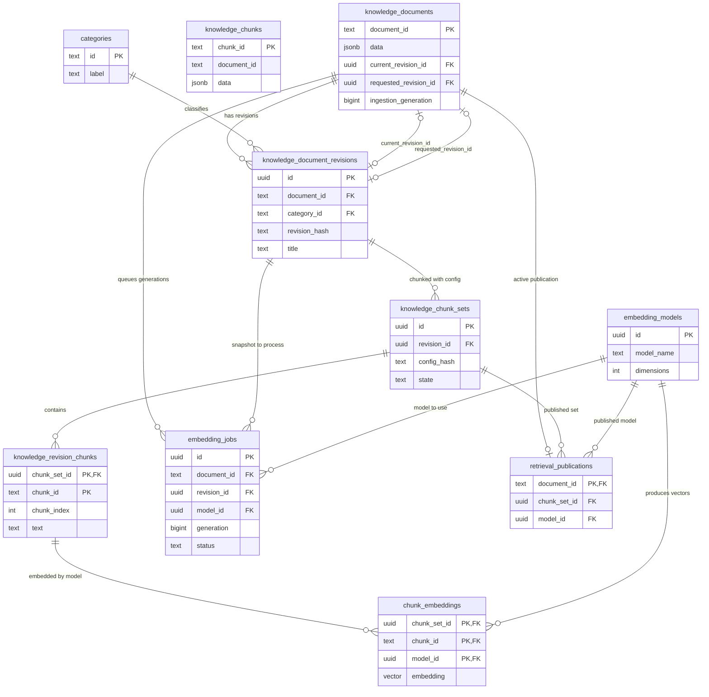
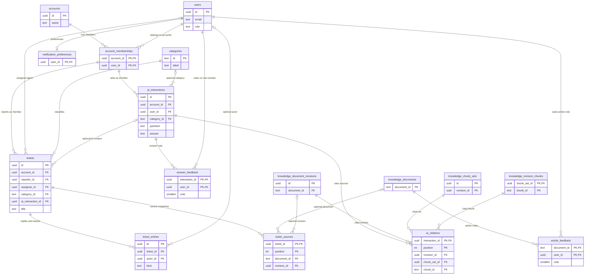

# Database SQL

SQL translation of `docs/superpowers/specs/2026-11-14-database-schema-design.md`.
These files are not automatically applied by the application or Docker Compose.
Run `001_schema.sql` once on PostgreSQL 16, either empty or containing the
scraper/importer's `public.knowledge_documents(document_id, data)` and
`public.knowledge_chunks(chunk_id, document_id, data)` staging tables.
Existing staging rows are retained. The documents table gains application columns;
its new timestamps reflect migration time. The chunks staging table is left intact,
so existing scraper writes continue to work. Application chunks are stored separately
in `knowledge_revision_chunks`, with embeddings and citations referencing that table.
Staged chunks are not automatically promoted or embedded: enqueue the staged
documents with the embedding worker, which creates revision-specific chunks.
Other application tables must not already exist. Use a migration owner, not the
application runtime role. The scripts assume the public schema.

From the repository root in PowerShell, with the Compose database already running:

```powershell
Get-Content -Raw backend/sql/001_schema.sql | docker compose exec -T postgres sh -c 'psql -X -v ON_ERROR_STOP=1 -U "$POSTGRES_USER" -d "$POSTGRES_DB"'
Get-Content -Raw backend/sql/003_seed_reference.sql | docker compose exec -T postgres sh -c 'psql -X -v ON_ERROR_STOP=1 -U "$POSTGRES_USER" -d "$POSTGRES_DB"'
```

Stop if either command exits unsuccessfully. Every script runs in a transaction.
The schema script is deliberately not rerunnable; record its application in your
migration process. Reference seeding is rerunnable and updates canonical labels.

## Table relationships

These Mermaid ER diagrams describe the schema after applying `001_schema.sql`,
`002_embeddings.sql`, and `004_embedding_jobs.sql`. Open this README in GitHub or
a Markdown preview with Mermaid support to see the diagrams.

`PK` means primary key; `FK` means foreign key. Multiple `PK` fields in one table
form a composite primary key. At a line's end, `||` means exactly one, `o|` means
zero or one, and `o{` means zero or many. Only keys and a few descriptive fields
are shown; the SQL scripts contain the full column definitions and constraints.
Tables repeated across diagrams are the same tables.

### Knowledge, chunks, and embeddings



The existing scraper writes JSON into `knowledge_documents` and `knowledge_chunks`.
`knowledge_chunks.document_id` identifies the source document, but these migrations
leave that table and any scraper-defined constraints untouched; no new FK is
implied by its presence here. It is separate from `knowledge_revision_chunks`.

The worker snapshots a staged document into `knowledge_document_revisions`, queues
an `embedding_jobs` row, and creates a configuration-specific `knowledge_chunk_sets`
row with `knowledge_revision_chunks` and `chunk_embeddings`. A successful run updates
`retrieval_publications` and the document's `current_revision_id`. The
`requested_revision_id` can point to a newer revision while work is pending.

Composite FKs keep a document's current/requested revision and each job's revision
within that same document. Each embedding references a chunk using both
`chunk_set_id` and `chunk_id`. A publication's set/model must also be checked by
the service for document ownership, readiness, and complete embedding coverage.

### Accounts, tickets, AI answers, and feedback



An account and user are linked through `account_memberships`. Both AI questions
and ticket reporters reference that membership using a composite FK. An assigned
agent references `users` directly. A ticket's optional AI interaction must belong
to the same account and reporter.

`ticket_entries` stores replies and events; system events can have no user actor.
`ticket_sources` preserves source snapshots with optional document/revision links.
`ai_citations` preserves the exact revision, chunk set, and chunk used in an answer;
composite FKs ensure those references agree. Answer feedback is restricted to the
interaction's user by `(interaction_id, user_id)`, whereas article feedback links
a user to a document.

## Embeddings

The design has not selected a model or vector dimension. `001_schema.sql` creates
the model registry and publications, but leaves `chunk_embeddings` to
`002_embeddings.sql`. Apply it once after selecting the model. For example, **only
if the selected model produces 1536 dimensions**:

```powershell
Get-Content -Raw backend/sql/002_embeddings.sql | docker compose exec -T postgres sh -c 'psql -X -v ON_ERROR_STOP=1 -v embedding_dimensions=1536 -U "$POSTGRES_USER" -d "$POSTGRES_DB"'
```

This example is not a model recommendation. Register the actual model/provider,
revision, dimension, and distance metric during ingestion. Do not create fake
model seed rows. Multiple dimensions require separately designed physical tables
or partitions and matching indexes. No HNSW index is created initially.

## Demo identities (optional)

`demo_identities.sql` seeds the frontend's demo people for `DEMO_AUTH=true`:
account `Demo Org`; customers `customer`, `mina` and `jordan` (the last cannot open
cases); agents `alex`, `priya` and `sam`. Send the subject as `X-Demo-User`. It is not
part of the required sequence, can run after `001_schema.sql` at any time, and is
rerunnable: existing rows are never overwritten, so profile edits survive.

```powershell
Get-Content -Raw backend/sql/demo_identities.sql | docker compose exec -T postgres sh -c 'psql -X -v ON_ERROR_STOP=1 -U "$POSTGRES_USER" -d "$POSTGRES_DB"'
```

## Do we need seed data?

Yes for the eight category reference rows: foreign keys and frontend category IDs
depend on them. Run `003_seed_reference.sql` before inserting tickets or promoted
knowledge revisions. It can run before the optional embedding script.

Demo accounts, users, tickets, replies, and votes are optional and intentionally
excluded. Real accounts and identities should come from onboarding/authentication.
Notification preferences can be initialized when creating a user. Knowledge content
comes from the existing import pipeline and a future promotion step, not this seed.
Statuses, severity levels, and user roles are CHECK constraints, not seed tables.

## Service responsibilities

This is DDL, not a completed persistence or authorization implementation. In
particular, implement account scoping, active membership/agent checks, consent
validation, timezone validation, ticket locking/version updates, and atomic event
writes in the service. Update `updated_at` explicitly on mutations (including
staging importer updates if that timestamp is needed). No RLS or runtime role
provisioning is applied here.

Composite foreign keys enforce citation revision/chunk consistency and ensure
answer feedback belongs to the interaction owner. The ingestion transaction must
still validate that a publication's set belongs to its document, is ready, and has
all embeddings for its model; validate model dimensions and cosine nonzero vectors
before publishing. Merely creating a publication row does not enforce these checks.
Keep historical records; foreign keys restrict deletion rather than cascading it.
Use `to_tsvector('english', ...)` in searches to match the provided GIN indexes.
