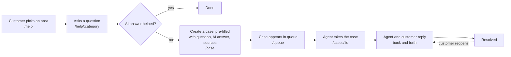
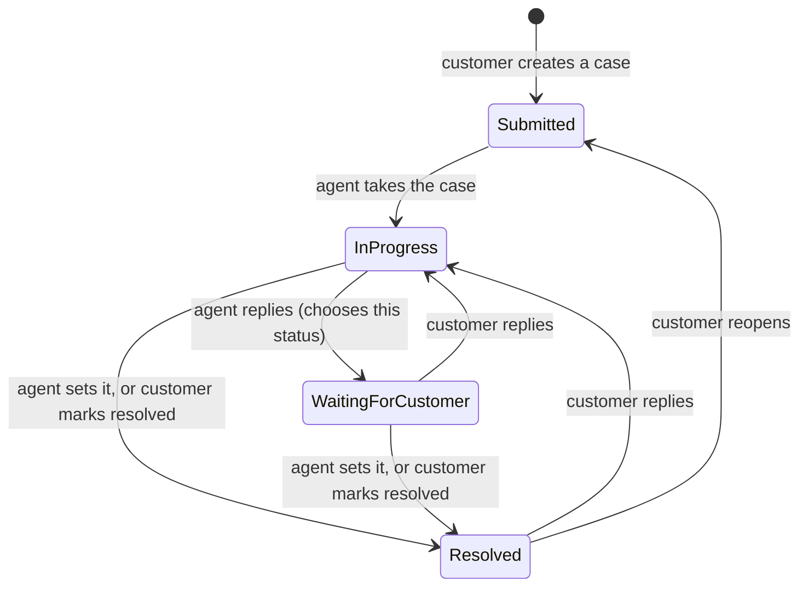

# Frontend pages and features

How the Support Copilot frontend is laid out, what each page and feature does, and which backend calls each one needs. This document is for backend developers who are building the API the frontend expects.

Source: `frontend/src`. Last updated 2026-11-10.

## At a glance

| | Count |
|---|---|
| Pages (one per URL) | **9** |
| Feature areas | **4**: assistant, knowledge base, cases, account |
| Features (things a user can do) | **17**, plus 1 demo-only role switch |
| Shared widgets | 3: Header, Footer, CaseTable |
| Backend endpoints the frontend needs | **15**: all exist and the frontend calls all of them |
| User roles | 2: `customer`, `agent` (support engineer) |

## Roles

| Role | Who | Home page | Main tabs |
|---|---|---|---|
| `customer` | Person with a product problem | `/help` | Get help, Knowledge base, Cases |
| `agent` | Support engineer | `/queue` | Support queue, All cases, Knowledge base |

The role comes from the backend (`GET /me`). The frontend only uses it to decide what to show. **The backend must check the role on every endpoint itself**, because anyone can call the API directly.

## Main workflow

The product exists for one hand-off: **the AI answers first, and a human takes over when the AI couldn't help.**



### Case status lifecycle



`InProgress` means "In progress", and `WaitingForCustomer` means "Waiting for customer". `Draft` exists in the status list but nothing creates it yet. Agents can also set any status directly from the case sidebar.

---

## Pages (9)

Each page is one URL. URLs use the hash form, for example `/#/cases/SC-10482`.

| # | Page | URL | Role | Purpose |
|---|---|---|---|---|
| 1 | Help (category picker) | `/help` | customer | Pick the problem area before asking |
| 2 | Ask | `/help/:category` | customer | Ask the AI and read the answer and sources |
| 3 | Knowledge base | `/kb` | both | Browse and search articles with filters |
| 4 | Article | `/kb/:articleId` | both | Read one article's summary and steps |
| 5 | Support queue | `/queue` | **agent only** | Escalated cases, sorted by severity then age |
| 6 | Cases | `/cases` | both | Full case list with filters and sort |
| 7 | Case detail | `/cases/:caseId` | both | Comment thread, replies, status changes |
| 8 | New case | `/case` | customer | Case form, optionally pre-filled from Ask |
| 9 | Account | `/account/:tab` | both | Profile, notifications and account info |

Extra routes that aren't pages:
- `/` sends the user to their home page based on role.
- `/account` goes to `/account/profile`.
- Any unknown URL shows "Page not found".

### 1. Help: `/help`
- **Shows:** 7 category cards (connectivity, performance, queries, replication, security, backup, drivers), plus "None of the above", which goes to `/help/any`.
- **Features:** Pick category.
- **Backend calls:** none. Categories are a fixed list in `shared/config/categories.ts`.

### 2. Ask: `/help/:category`
- Shows a question box, the answer and its cited source sections, related articles, and a "Create a case" button. When evidence is insufficient, the assistant asks for more detail.
- **Features:** Ask the assistant, Rate the answer, Create a case (starting point).
- Calls `POST /chat` for the answer and searches separately for related articles.
- A service error offers retry for the submitted question.

### 3. Knowledge base: `/kb`
- **Shows:** a search box; filters for Type, Product and Topic with counts; and the results. With no search or filter, it shows recently published articles.
- **Features:** Browse and search articles.
- **Backend calls:** `GET /articles`, `GET /articles/search?q=`.

### 4. Article: `/kb/:articleId`
- **Shows:** summary, steps, note, metadata, related articles in the same topic, a "Was this helpful?" vote, and a link to ask the assistant about this topic.
- **Features:** Read article.
- **Backend calls:** `GET /articles/:id`, `GET /articles`.
- **Not found:** shows "Article not found".

### 5. Support queue: `/queue` (agent only)
- **Shows:**
  - Stats: unassigned, assigned to me, waiting on customer, critical open.
  - View tabs: Unassigned, Assigned to me, All open.
  - A case table with a "Take case" button on unassigned rows.
- **Features:** Work the queue, Take case.
- **Backend calls:** `GET /me`, `GET /tickets`, `POST /tickets/:id/take`.
- **Sort order:** highest severity first, then oldest first.
- **Customers** who open this URL go to `/help` instead.

### 6. Cases: `/cases`
- **Shows:**
  - Stats: open, waiting on customer, high/critical open, resolved.
  - Status tabs, a text search (ID, title or assignee), area and severity filters, and a sort option (last updated, newest, highest severity).
  - The case table.
- **Features:** List cases.
- **Backend calls:** `GET /me`, `GET /tickets`.
- **Scope:** customers see their own account's cases; agents see every case.

### 7. Case detail: `/cases/:caseId`
- **Shows:** title, status, created and updated dates, description, the AI answer that failed (with source links), and a timeline of comments and system events.
  - **Customers** get a reply box and a "Mark as resolved" or "Reopen case" button.
  - **Agents** get a reply box with a "set status after sending" option, a "Take case" button, and a sidebar where they can change assignee, status and severity.
- **Features:** Case thread, Reply, Update case (agent), Resolve or reopen (customer), Take case.
- **Backend calls:** `GET /me`, `GET /tickets/:id`, `GET /agents`, `POST /tickets/:id/replies`, `PATCH /tickets/:id`, `POST /tickets/:id/take`.
- **Not found:** shows "Case … not found".

### 8. New case: `/case`
- **Shows:** a form with title, area, severity, description and a consent checkbox. When the user arrives from Ask, the form is pre-filled with the question, a description template and the "Articles already consulted" list. The pre-filled data survives a page reload.
- After submitting, it shows a confirmation with the case ID and a "View case" link.
- **Features:** Create case.
- **Backend calls:** `POST /tickets`.

### 9. Account: `/account/:tab`
Which tabs appear depends on the role:

| Tab | customer | agent | Backend calls |
|---|---|---|---|
| `profile` | ✓ | ✓ | `GET /profile`, `PUT /profile` |
| `notifications` | ✓ | ✓ | `GET /profile`, `PUT /profile` |
| `team` | ✓ | | `GET /team` |
| `subscription` | ✓ | | `GET /tickets` (to count open cases) |
| `workload` | | ✓ | `GET /me`, `GET /tickets` (open cases assigned to me) |

- **Features:** Edit profile, Notification preferences, View team, View subscription, View workload.
- Saving the profile also refreshes the name in the header, which re-fetches `GET /me`.

---

## Features (17)

The code is in `frontend/src/features/<area>/`. Every backend call goes through `frontend/src/shared/api/`.

### Assistant (3): `features/assistant/`
| # | Feature | What it does | Backend |
|---|---|---|---|
| 1 | Pick category | Narrows the AI search to one area before the question is asked | none |
| 2 | Ask the assistant | Answers from published passages and displays the cited sections or a clarifying question | `GET /articles/search`, `POST /chat` |
| 3 | Rate the answer | Thumbs up or down on the AI answer | **not saved yet**: needs an endpoint (see Gaps) |

### Knowledge base (2): `features/knowledge-base/`
| # | Feature | What it does | Backend |
|---|---|---|---|
| 4 | Browse and search articles | Text search, facet filters with counts, pagination (5 per page on Ask) | `GET /articles`, `GET /articles/search` |
| 5 | Read article | Steps, note, related articles, "Was this helpful?" vote (vote **not saved yet**) | `GET /articles/:id` |

### Cases (7): `features/cases/`
| # | Feature | Who | What it does | Backend |
|---|---|---|---|---|
| 6 | Create case | customer | Submits a new case. When created from Ask, it carries the question, the AI answer and the sources | `POST /tickets` |
| 7 | List cases | both | Filter, search and sort cases | `GET /tickets` |
| 8 | Work the queue | agent | Views of open cases: unassigned, mine, all | `GET /tickets` |
| 9 | Take case | agent | Assigns the case to me and sets it to In progress | `POST /tickets/:id/take` |
| 10 | Case thread | both | Description, the AI answer that failed, comments and system events | `GET /tickets/:id` |
| 11 | Reply | both | Adds a comment; the status changes as the rules below describe | `POST /tickets/:id/replies` |
| 12 | Update case | agent: assignee, status, severity. customer: resolve or reopen | Changes case fields and logs a system event | `PATCH /tickets/:id` |

### Account (5): `features/account/`
| # | Feature | Who | Backend |
|---|---|---|---|
| 13 | Edit profile (name, email, company, phone, time zone) | both | `GET /profile`, `PUT /profile` |
| 14 | Notification preferences (replies, status changes, weekly digest) | both | `GET /profile`, `PUT /profile` |
| 15 | View team (members, roles, can open cases) | customer | `GET /team` |
| 16 | View subscription (plan, open cases, response targets by severity) | customer | `GET /tickets` |
| 17 | View workload (my open assigned cases) | agent | `GET /me`, `GET /tickets` |

### Demo only
- **Role switch** (the Customer/Support buttons in the header) stands in for login. **Remove it once `GET /me` comes from real auth.**

### Shared widgets: `widgets/`
- **Header:** tabs per role, a "Create a case" button (customers), and the profile menu. Reads `GET /me`.
- **CaseTable:** the case table used by both the Queue and Cases pages.
- **Footer.**

---

## Backend API the frontend expects

The status column means:
- **Exists:** the backend has it today.
- **Demo:** the frontend fakes it in the browser (none today).

Paths marked *proposed* are the frontend's suggestion. If the backend picks different paths, only the matching function in `frontend/src/shared/api/*.ts` has to change.

| # | Method and path | Status | Request | Response | Frontend function |
|---|---|---|---|---|---|
| 1 | `POST /chat` | **Exists** | `{ question: string, category: string \| null }` | Answer text, status and ordered sources | `askChat` (`chat.ts`) |
| 2 | `GET /me` | **Exists** | | `Me` | `getMe` (`users.ts`) |
| 3 | `GET /agents` (agents only) | **Exists** | | `string[]` (agent names) | `listAgents` (`users.ts`) |
| 4 | `GET /profile` | **Exists** | | `Profile` | `getProfile` (`profile.ts`) |
| 5 | `PUT /profile` | **Exists** | `Profile` | `Profile` | `saveProfile` (`profile.ts`) |
| 6 | `GET /team` (customers only) | **Exists** | | `TeamMember[]` | `listTeam` (`profile.ts`) |
| 7 | `GET /articles` | **Exists** | | `Article[]` | `listArticles` (`articles.ts`) |
| 8 | `GET /articles/:id` | **Exists** | | `ArticleDetail`, or 404 | `getArticle` (`articles.ts`) |
| 9 | `GET /articles/search?q=&topic=` | **Exists** | | `Article[]`, ranked best first | `searchArticles` (`articles.ts`) |
| 10 | `GET /tickets` | **Exists** | | `Ticket[]` | `listTickets` (`tickets.ts`) |
| 11 | `GET /tickets/:id` | **Exists** | | `Ticket`, or 404 | `getTicket` (`tickets.ts`) |
| 12 | `POST /tickets` | **Exists** | `NewTicket` | `Ticket` | `createTicket` (`tickets.ts`) |
| 13 | `PATCH /tickets/:id` | **Exists** | `TicketPatch` | `Ticket` | `updateTicket` (`tickets.ts`) |
| 14 | `POST /tickets/:id/take` | **Exists** | | `Ticket` | `takeTicket` (`tickets.ts`) |
| 15 | `POST /tickets/:id/replies` | **Exists** | `{ body: string, status?: Status }` | `Ticket` | `replyToTicket` (`tickets.ts`) |

Notes:
- **Tickets (rows 10 to 15):** `id` is `SC-<case number>`. Case ids that are malformed or too large return 404, never 500. Lists and single reads use a fixed number of queries. Reads: customers see their account's tickets (403 without an active membership; another account's ticket is 404), agents see all. Writes lock the ticket row and commit the ticket and its comments together; a patch that changes nothing returns the ticket untouched. Check order: 401, role 403, 404, ownership 403, then 409/422 on state. `POST /tickets` needs `consent: true`, returns 201, and stores `consent_at` with the version `case-share-v1`; members with `can_open_cases=false` get 403. `assignee` is an agent display name that must match exactly one active agent (otherwise 422); `null` or `""` unassigns and a missing field leaves it unchanged. `PATCH {}` and a null `status` or `severity` are 422. Only the reporter replies, resolves or reopens; other members of the account can read. Reopen (`Submitted`) is valid only from `Resolved`, else 409. Take is 409 unless the ticket is unassigned and Submitted, In progress or Waiting for customer; two simultaneous takers get one 200 and one 409.
- **Identity (rows 2 to 9):** there is no login yet. The role toggle sends `X-Demo-User: customer` or `alex` (`shared/api/identity.ts`); `mina`, `jordan`, `priya` and `sam` also exist. The backend honours it only with `DEMO_AUTH=true` on a loopback `API_HOST`; otherwise these endpoints return 401. Errors are `{"detail": ...}`: 401 no valid user, 403 wrong role, 404 missing, 422 invalid input, 503 database unavailable.
- **Articles:** `updated` is ISO 8601. `content` (markdown) and `sourceUrl` come with `GET /articles/:id`; `body` appears only when the stored article has `{steps, note?}` steps. Excerpts are plain text. Search matches any query word, ranks best first (title above body) and returns at most 50.
- `GET /agents` is agent-only, so the case page only loads it for agents. `GET /team` is customer-only.
- The Ask page sends the category ID, for example `"connectivity"`, or `null` for "None of the above". The API also accepts legacy display labels.
- **Every ticket write returns the full updated `Ticket`.** The frontend puts it straight into its cache and refreshes the case lists.
- **404 for a missing ticket or article:** the frontend shows its "not found" screen when these functions return `null`. When you wire up the real call, map a 404 to `null` in that function.
- **Errors:** any non-2xx response throws in `shared/api/client.ts`. The page that made the call decides what to show.
- **Base URL:** `VITE_API_URL` in `frontend/.env`. The default is `http://localhost:8000`.

## Data models

These are the shapes the frontend reads and writes. Field names are camelCase. If the backend uses snake_case, convert it in `shared/api/*.ts` so pages never see the difference.

```ts
type Role = 'customer' | 'agent'
type Me = { name: string; email: string; company: string; role: Role }

type Status = 'Draft' | 'Submitted' | 'In progress' | 'Waiting for customer' | 'Resolved'
type Severity = 'Low' | 'Normal' | 'High' | 'Critical'

type Ticket = {
  id: string            // e.g. "SC-10482"
  title: string
  category: string      // category id, e.g. "connectivity"
  status: Status
  severity: Severity
  created: string       // ISO timestamp; please include a timezone
  updated: string       // ISO timestamp; please include a timezone
  summary: string
  description?: string
  reporter: string      // customer name
  company: string       // account name (fills the case sidebar)
  plan: string          // account plan code, e.g. "developer"
  sources: { id?: string; title: string; url?: string }[]  // articles the AI used; id is missing if the article was removed or unknown
  aiAnswer?: string     // AI answer the customer saw before escalating
  assignee?: string     // agent name; missing = unassigned
  comments: Comment[]   // oldest first
}
type Comment = { author: string; role: 'customer' | 'agent' | 'system'; at: string; body: string }

type NewTicket = { title: string; category: string; severity: Severity; description?: string; sources?: { id?: string; title: string; url?: string }[]; aiAnswer?: string; consent: true }  // consent is required; the server stores consent_at and "case-share-v1"
type TicketPatch = { status?: Status; assignee?: string | null; severity?: Severity }  // assignee null or "" = unassign; missing = unchanged; at least one field; status/severity cannot be null

type Article = {
  id: string; title: string
  type: 'Knowledge Article' | 'Documentation' | 'Community Forum' | 'Video'
  product: 'Atlas' | 'Server' | 'Drivers' | 'Ops Manager'
  topic: string         // category id
  updated: string       // ISO 8601 with offset, e.g. "2026-11-16T00:00:00Z"
  excerpt: string
}
type ArticleDetail = Article & { content: string; sourceUrl: string; body?: { steps: string[]; note?: string } }  // content is markdown

type Profile = {
  name: string; email: string; company: string; timezone: string; phone: string
  notify: { replies: boolean; status: boolean; digest: boolean }
}
type TeamMember = { name: string; email: string; role: string; cases: boolean }
```

## Business rules the backend must own

The backend owns these rules (`backend/src/support_copilot/application/ticket_rules.py`, pure functions). Where the 2026-11-25 frontend-APIs spec decides differently from the text below, the spec wins and the text below says so.

### Permissions
| Action | customer | agent |
|---|---|---|
| Read tickets | own account's only | all |
| Create ticket | ✓ (membership must allow opening cases) | |
| Reply | tickets they reported (other members of the account only read) | any ticket |
| Take ticket | | ✓ (unassigned and open only) |
| Change assignee or severity | | ✓ |
| Change status | only to `Resolved` (mark resolved) or `Submitted` (reopen, from `Resolved` only), on tickets they reported | any status |
| Read agents list | | ✓ |
| Read team / subscription | ✓ | |

### What each write does
- **Create** (`POST /tickets`):
  - Requires `consent: true`. The server generates `id`, sets `status = Submitted`, sets `created` and `updated` to now, and sets `reporter` from the signed-in user.
  - It takes `summary` from the first 200 characters of `description`.
  - It adds the system comment "Escalated after the AI suggestion did not help" when `aiAnswer` is present, and "Case opened" otherwise.
- **Take** (`POST /tickets/:id/take`): sets `assignee = me` and `status = In progress`, and adds the system comment "*{name}* took the case".
- **Reply** (`POST /tickets/:id/replies`):
  - Adds a comment whose author is the signed-in user and whose role is that user's role. The author is always the signed-in user, never the assignee (this replaces the demo behaviour of using the assignee).
  - **Agent reply:** the status becomes the `status` sent with the request, or stays unchanged when none is sent. If the ticket was unassigned, it's also assigned to the agent.
  - **Customer reply:** sending `status` is 403. A ticket in `Waiting for customer` or `Resolved` moves back to `In progress`. Any other status stays as it is.
  - The reply comes first; if the status changed, the system comment "Status changed to *{status}*" follows it. Assigning an unassigned ticket on an agent reply adds no event.
- **Update** (`PATCH /tickets/:id`): a missing field is unchanged (the older "missing assignee = unassign" rule is replaced by `null` or `""`). Adds one system comment per field that actually changed, in this order:
  - Status changed by an agent: "Status changed to *{status}*".
  - Status changed by a customer: "Customer marked the case resolved" or "Customer reopened the case".
  - Assignee: "Assigned to *{name}*", or "Unassigned".
  - Severity: "Severity changed to *{severity}*".
- **Every effective write** updates `updated` to now, increments the ticket `version`, and keeps `resolved_at` set exactly while the status is `Resolved` (the original value is kept when it was already resolved). A write that changes nothing changes neither `updated` nor `version`.

### Response-time targets (shown on the Subscription tab)
| Severity | First response target |
|---|---|
| Low | 2 business days |
| Normal | 1 business day |
| High | 8 hours |
| Critical | 1 hour |

## Gaps and open questions for the backend

1. **Login:** `GET /me` exists, but identity is the `X-Demo-User` demo header (`DEMO_AUTH`). Real login should replace the one `current_user` dependency.
2. **Feedback votes aren't saved.** The AI answer vote (Ask page) and the article "Was this helpful?" vote are only kept on screen. A possible endpoint is `POST /feedback { target: 'answer' | 'article', id, vote: 'up' | 'down' }`.
3. **Article `updated`** resolved. It is an ISO 8601 timestamp; the knowledge base shows the 10 newest articles as recent.
4. **Account info on the case sidebar:** resolved. `Ticket` now carries `company` and `plan` (the plan code, e.g. `developer`); the sidebar shows both. The Subscription tab's plan is still fixed text, because no endpoint returns the account.
5. **Timestamps:** resolved for the ticket endpoints, which return ISO 8601 timestamps with an offset (for example `2026-11-09T11:08:00Z`).
6. **`Draft` status** is defined but nothing creates it. Keep it only if drafts are planned. The API accepts it from agents; `take` answers 409 for a draft.
7. **Categories** are a fixed list in the frontend. Move them to `GET /categories` if they ever need to be editable.

## Where the frontend code lives

```
frontend/src/
  app/router.tsx        all routes, role redirects, layout
  pages/                the 9 pages above
  widgets/              Header, Footer, CaseTable
  features/             assistant, knowledge-base, cases, account
  shared/api/           one file per backend resource, the only code that calls the backend
  shared/api/identity.ts  the demo user behind the role toggle; replace with real login
  shared/api/queries.ts cache keys used for loading and refreshing data
```
