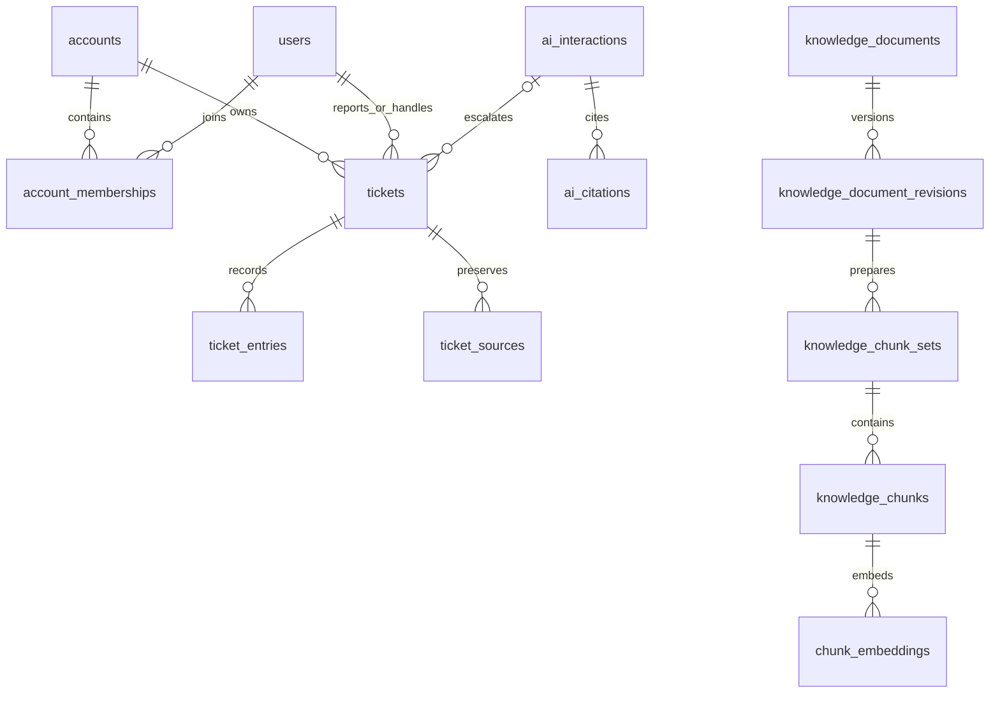

# Support Copilot database schema

Proposed design, 2026-11-14. This document does not apply database changes.

The schema supports the existing customer → AI answer → support case workflow, account-scoped case visibility, agent queues, knowledge browsing, and feedback. It builds on PostgreSQL 16 and pgvector already configured in Docker Compose.

## Approach and assumptions

Use relational tables for application records and foreign keys, JSONB for imported document payloads and event details, and versioned knowledge content for retrieval. A JSONB-only application schema would weaken relationships and make queue queries harder; a separate vector database would add synchronization work with no demonstrated need. This is the designer's recommendation, not a previously approved user decision.

Customers belong to accounts; agents are global support staff. Customers may read their account's tickets, but only the reporter may reply or resolve/reopen a ticket, following the permissions document's distinction between account visibility and own-ticket writes. Team-wide editing can be added if intended. Authentication uses an external identity subject; provider selection remains open. Billing, attachments, private agent notes, notification delivery, and SLA enforcement are outside this first schema.

## Conventions

Application IDs are UUIDs generated by the application. Existing deterministic document and chunk IDs remain text. All timestamps are `timestamptz`, stored as instants and returned as ISO 8601 with an offset. Columns are NOT NULL unless marked `?`. Use text plus CHECK constraints for small value sets, rather than PostgreSQL enums. Every ordinary entity has `created_at` and `updated_at`; immutable records only need `created_at`. Primary keys and UNIQUE constraints supply their own indexes.

## Identity and account tables

| Table | Columns and constraints |
|---|---|
| `accounts` | `id uuid PK`, `name text`, `plan_code text` (display metadata, initially `developer`), timestamps |
| `users` | `id uuid PK`, `auth_issuer text`, `auth_subject text`, `email text`, `display_name text`, `role text CHECK IN ('customer','agent')`, `company text?`, `phone text?`, `timezone text DEFAULT 'UTC'`, `is_active boolean DEFAULT true`, timestamps; UNIQUE `(auth_issuer, auth_subject)` |
| `account_memberships` | `account_id uuid FK accounts`, `user_id uuid FK users`, `team_role text`, `can_open_cases boolean DEFAULT true`, `is_active boolean DEFAULT true`, timestamps; PK `(account_id,user_id)` |
| `notification_preferences` | `user_id uuid PK/FK users`, `replies boolean DEFAULT true`, `status_changes boolean DEFAULT true`, `weekly_digest boolean DEFAULT false`, timestamps |
| `categories` | `id text PK`, `label text`, `sort_order smallint`; seed the seven frontend categories plus `any` |

Do not use email or a display name as identity. Profile company text must not change account membership or permissions. Validate IANA timezone names in the service. Account membership writes are privileged; membership flags and roles never come from a general profile update. Use deactivation instead of deleting users or memberships referenced by cases.

## Cases and history

| Table | Columns and constraints |
|---|---|
| `tickets` | `id uuid PK`, `case_number bigint GENERATED ALWAYS AS IDENTITY UNIQUE`, `account_id uuid`, `reporter_id uuid`, `assignee_id uuid? FK users`, `category_id text FK categories`, `title text`, `description text DEFAULT ''`, `status text DEFAULT 'submitted'`, `severity smallint DEFAULT 2`, `ai_interaction_id uuid?`, `ai_answer_snapshot text?`, `consent_at timestamptz`, `consent_version text`, `version bigint DEFAULT 1`, `resolved_at timestamptz?`, timestamps |
| `ticket_entries` | `id uuid PK`, `ticket_id uuid FK tickets`, `actor_id uuid? FK users`, `actor_name_snapshot text`, `actor_role text CHECK IN ('customer','agent','system')`, `kind text CHECK IN ('reply','event')`, `body text`, `event_type text?`, `event_data jsonb?`, `created_at timestamptz` |
| `ticket_sources` | `ticket_id uuid FK tickets`, `position integer CHECK > 0`, `document_id text? FK knowledge_documents`, `revision_id uuid? FK knowledge_document_revisions`, `title_snapshot text`, `url_snapshot text?`; PK `(ticket_id,position)` |

Tickets have a composite FK `(account_id,reporter_id)` to memberships. Check status against `draft`, `submitted`, `in_progress`, `waiting_for_customer`, `resolved`; retain draft for compatibility but create submitted tickets by default. Severity is 1=Low, 2=Normal, 3=High, 4=Critical with CHECK BETWEEN 1 AND 4. Require nonblank title and `version > 0`. Require `resolved_at IS NOT NULL` exactly when status is resolved.

Add `entry_number bigint GENERATED ALWAYS AS IDENTITY UNIQUE` to ticket entries. Allocate entries while holding the ticket lock, and order the timeline by entry number so replies precede their resulting events even when timestamps match. Ticket sources use a composite FK `(document_id,revision_id)` to revisions `(document_id,id)` and CHECK `(revision_id IS NULL OR document_id IS NOT NULL)`.

Expose `SC-` plus `case_number` as the existing public ID; never allocate with MAX+1. Derive summary from the first 200 description characters. Names in API responses are display fields; assignment requests must use agent IDs. Enforce active-agent assignment in the service inside the write transaction. Replies require an actor; system-generated events may have none. The authenticated author is always recorded, even when another agent owns the case; correct the demo behavior that attributes replies to the assignee.

All mutations lock the ticket or use compare-and-swap on `version`, update timestamps/version, and append events in one transaction. Taking a case uses a conditional update requiring NULL assignee and open status; a second claimant receives a conflict. Apply reply/status rules from `docs/frontend/pages-and-features.md`. Missing patch fields mean unchanged; explicit null assignee means unassign. Consent is captured server-side after validating the checkbox and applicable text version; add those inputs to the current create-ticket request.

## Knowledge and retrieval

| Table | Columns and constraints |
|---|---|
| `knowledge_documents` | Keep existing `document_id text PK`, `data jsonb NOT NULL`; add `is_active boolean DEFAULT true`, `current_revision_id uuid?`, timestamps |
| `knowledge_document_revisions` | `id uuid PK`, `document_id text FK knowledge_documents`, `revision_hash text`, `content_hash text`, `title text`, `source_url text`, `source_type text`, `product text`, `deployment text`, `version_scope text`, `category_id text FK categories`, `topics text[]`, `content_markdown text`, `excerpt text`, `display_body jsonb?`, `source_payload jsonb`, `fetched_at timestamptz`, `created_at timestamptz`; UNIQUE `(document_id,revision_hash)`, UNIQUE `(document_id,id)` |
| `knowledge_chunk_sets` | `id uuid PK`, `revision_id uuid FK knowledge_document_revisions`, `chunker_version text`, `config_hash text`, `state text CHECK IN ('preparing','ready','failed')`, `created_at timestamptz`; UNIQUE `(revision_id,chunker_version,config_hash)` |
| `knowledge_chunks` | `chunk_set_id uuid FK knowledge_chunk_sets`, `chunk_id text`, `chunk_index integer CHECK >= 0`, `heading_path text[]`, `text text`, `char_count integer CHECK > 0`, `oversized boolean`; PK `(chunk_set_id,chunk_id)`, UNIQUE `(chunk_set_id,chunk_index)` |
| `embedding_models` | `id uuid PK`, `provider text`, `model_name text`, `model_revision text`, `dimensions integer CHECK > 0`, `distance_metric text`, `is_active boolean`; UNIQUE `(provider,model_name,model_revision,dimensions)` |
| `chunk_embeddings` | `chunk_set_id uuid`, `chunk_id text`, `model_id uuid FK embedding_models`, `embedding vector(D)`, `created_at timestamptz`; composite FK to chunks; PK `(chunk_set_id,chunk_id,model_id)` |
| `retrieval_publications` | `document_id text PK/FK knowledge_documents`, `chunk_set_id uuid FK knowledge_chunk_sets`, `model_id uuid FK embedding_models`, `published_at timestamptz` |

`D` is deliberately unresolved until the embedding model is selected; it is not executable DDL. Start with one fixed model/dimension and a matching cosine index if cosine is chosen. Different dimensions require separate physical embedding tables/partitions with matching indexes. Never compare embeddings across models. Validate vector dimension, nonzero vectors for cosine, and publication model consistency on ingestion.

The revision hash covers normalized content and citation/filter metadata, excluding fetch timestamps. Thus metadata-only edits create a new revision; identical reruns do not. A composite FK `(document_id,current_revision_id)` references revisions `(document_id,id)` so a document cannot point to another document's revision. Add this FK after both tables exist. Chunk identity is scoped to its set because deterministic IDs can recur across preparation configurations.

Stage a full chunk set and all embeddings before atomically replacing its publication. The ingestion transaction verifies the set belongs to the publication's document, is ready, and has a complete embedding set for its model. Retrieval only joins active documents through published sets; partial refreshes never become searchable. Keep prior revisions/sets when referenced by citations. A failed refresh retains the previous publication. Missing documents in a partial import are not automatically deactivated.

Retain the current JSONB importer as a staging import initially. A separate promotion command validates payloads, creates revisions/chunks, and publishes retrieval data. `data` means latest imported payload; it is not automatically the published version. Serve KB articles from the current promoted revision, with markdown support added to the frontend; `display_body` may retain legacy curated steps/note. Do not invent steps by splitting arbitrary markdown. Normalize source types and product labels during promotion to the existing frontend values.

## AI interactions, citations, and votes

| Table | Columns and constraints |
|---|---|
| `ai_interactions` | `id uuid PK`, `account_id uuid`, `user_id uuid`, `category_id text? FK categories`, `question text`, `answer text?`, `state text CHECK IN ('pending','completed','failed')`, `model_name text?`, `prompt_version text?`, `error_code text?`, `created_at timestamptz`, `completed_at timestamptz?`; composite FK `(account_id,user_id)` to memberships; UNIQUE `(account_id,user_id,id)` |
| `ai_citations` | `interaction_id uuid FK ai_interactions`, `position integer CHECK > 0`, `revision_id uuid FK knowledge_document_revisions`, `chunk_set_id uuid`, `chunk_id text`, `title_snapshot text`, `url_snapshot text`, `excerpt_snapshot text`, `score double precision?`; composite FK to chunks; PK `(interaction_id,position)` |
| `answer_feedback` | `interaction_id uuid FK ai_interactions`, `user_id uuid FK users`, `vote smallint CHECK IN (-1,1)`, timestamps; PK `(interaction_id,user_id)` |
| `article_feedback` | `document_id text FK knowledge_documents`, `user_id uuid FK users`, `vote smallint CHECK IN (-1,1)`, timestamps; PK `(document_id,user_id)` |

Add a composite ticket FK `(account_id,reporter_id,ai_interaction_id)` to interactions, preventing cross-account or other-user escalation. A direct case may have no interaction. Copy answer and source snapshots at escalation so the case remains understandable independently of retrieval changes. Validate citation revision/chunk-set consistency during persistence (or enforce with additional composite unique keys/FKs in migrations). Only the interaction owner may rate an answer. Use upserts for votes. Completed interactions require a non-null answer and completion time; failed ones require an error code. Return interaction ID and actual retrieved citations from POST /chat; the current answer-only response cannot support persistent votes or reliable escalation links.

## Relationships

## Query indexes and access controls

- Tickets: `(account_id,updated_at DESC,id)` for customer lists; `(updated_at DESC,id)` for agent lists; partial `(severity DESC,created_at,id)` WHERE status IN ('submitted','in_progress','waiting_for_customer') AND assignee_id IS NULL for unassigned queue; partial `(assignee_id,severity DESC,created_at,id)` for those same open states. Add `(reporter_id)` and indexes for remaining FK lookups as required by deletion/update paths.
- Entries: `(ticket_id,entry_number)` for stable chronological pagination. Sources already use a ticket-leading PK.
- Memberships: `(user_id,account_id)` for resolving available accounts.
- Interactions: `(account_id,user_id,created_at DESC,id)`; index ticket `ai_interaction_id` and citation revision/chunk references.
- Revisions: `(category_id,product,source_type)` for facets; full-text GIN on title/excerpt/content search vector. Use PostgreSQL text search first and evaluate fuzzy search separately. Ticket text search can use a title/description search vector, with exact case-number lookup and an assignee join.
- Chunks: GIN full-text index for lexical retrieval; embeddings: model-specific HNSW index matching the chosen distance operator when corpus size warrants it. Start the small corpus with exact vector search. Filter category/product/version before returning matches and measure recall before changing index strategy.

All customer queries must derive account membership from authenticated identity; never trust a body account ID alone. Scope ticket access before loading entries or sources. Global agent access is explicit. RLS can be added as defense in depth once request/connection identity propagation is implemented; this design initially requires centralized repository scoping and cross-account integration tests. The application runtime role must not own schema changes or staging imports.

FK deletion defaults to RESTRICT for accounts, users, tickets, interactions, and historical knowledge. Deactivate documents and users during normal operation. Any future retention purge must explicitly remove dependent feedback/citations/history or preserve approved snapshots in a transaction; no automatic cascading deletion of support history.

## Delivery and verification

1. Introduce ordered migrations and create identity, account, category, ticket, and history tables. Seed reference values; keep demo data separate.
2. Extend the existing knowledge table additively, promote existing JSONB rows, and validate deterministic IDs and content hashes. Existing importer inserts must remain valid using nullable/defaulted added columns.
3. Implement interactions/citations/feedback and choose the embedding model before producing concrete vector DDL. Stage and publish the first retrieval corpus.
4. Replace frontend demo adapters with API mappings, IDs for agents, real timestamps, consent fields, interaction IDs, and markdown article bodies.
5. Verify migrations on an empty database and a copy with existing imported documents; test cross-account denial, simultaneous case claims, rollback of reply/events, repeat import idempotency, incomplete embedding refresh, citation stability after reimport, and vote uniqueness.

This is a design artifact; migrations, database execution, and runtime tests are subsequent implementation work. No production data or current importer behavior is changed by this document.
